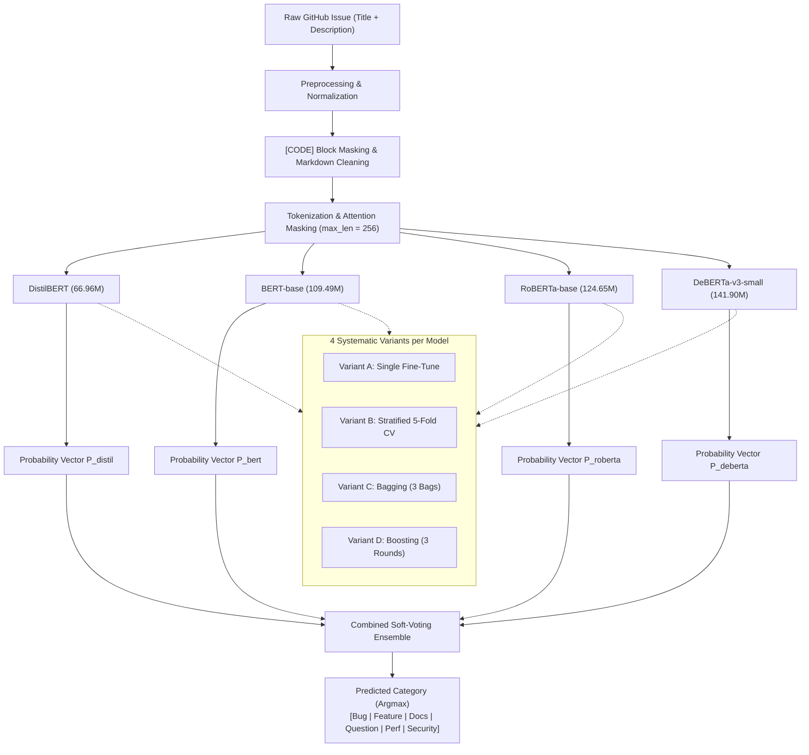

# GitSort

GitSort classifies GitHub issues into six categories using fine-tuned Transformer models:

- Bug
- Feature Request
- Documentation
- Question
- Performance
- Security

## System Architecture



## Results

The combined soft-voting ensemble achieved:

- 83.07% test accuracy
- 96.63% ROC-AUC

The best standalone model was RoBERTa-base with the boosting variant:

- 82.65% test accuracy
- 80.90% macro F1

## Setup

Requirements: Python 3.9-3.11.

```bash
git clone https://github.com/<your-username>/gitsort.git
cd gitsort
python -m venv .venv
```

Activate the environment:

```bash
# macOS/Linux
source .venv/bin/activate

# Windows
.venv\Scripts\activate
```

Install dependencies and launch Jupyter:

```bash
pip install -r requirements.txt
jupyter lab
```

Run the notebooks in `notebooks/` to reproduce the experiments.

## Dataset

The `data/` directory contains 3,541 labeled GitHub issues:

- `train.csv`: training data
- `label_map.json`: label-to-ID mapping

Each record includes the repository, issue title, description, label, and shard.

## Repository Structure

```text
data/       Dataset and label mapping
notebooks/  Training and evaluation notebooks
README.md   Project documentation
```

## License

This project is licensed under the MIT License.
